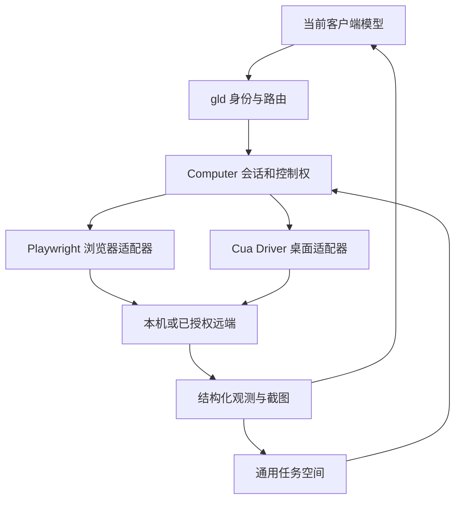

# RFC-0011：浏览器与跨平台桌面 Computer Use（历史选型）

起草日期：2026-10-26。**2026-10-28 用户明确收缩范围：本 RFC 的默认 Cua-first 路线、
三套 computer 会话接口与 C0–C6 顺序，已由 [RFC-0013](0013-native-machines-and-desktop.md) 替代。**
现在优先直接依赖小型 Rust 桌面库，目标机用 gld 自身主动接入同一个 Hub；不要求安装 Cua 或 ccnm。
本文保留为历史取舍与既有 `computer probe` 的研究依据，旧章节链接继续可用，不再据此排默认开发。
已实现的通用任务空间和产物能力不回滚，probe 也不自动删除或继续扩建。
当前进度只在 [task_plan.md](../../task_plan.md)，已实现工具的实际用法见 concepts；
“上游声明支持”“gld 接入通过”“真机任务通过”始终分别记录。

## 1. 目标与默认路线

用户希望在普通聊天中操作不同平台的应用，且无需为每个非项目任务手动创建项目。
目标是：发现目标 → 读取界面结构和截图 → 执行动作 → 再次观察核实 → 交付产物和收尾。

原方案默认路线（历史，不是当前实施要求）：

- **通用任务空间**：采用 [RFC-0010](0010-managed-work-sessions.md)，承载文件、截图、浏览器 profile 和资源归属。
- **浏览器**：继续复用 Microsoft Playwright MCP，补任务绑定和生命周期。
- **原生桌面**：优先验证独立的 Cua Driver MCP；接入受控执行层，不引入其云产品或第二套模型循环。
- **平台替换**：macOS 备选 Peekaboo；Windows 备选微软 winapp ui，再按实际需要评估 Windows-MCP。
- **推理**：当前 ChatGPT、Codex 或其他连接客户端继续决定步骤。gld 不替客户端购买模型 API、调度另一个 agent 或下载视觉解析模型。
- **远端**：执行器运行在被控机器的图形用户会话中，通过已有可信通道传递调用和图像；网络连通与桌面可用分别检查。
- **移动端**：Android/iOS 作为后续独立 provider；桌面首版不承诺手机完整控制。

**实施原则：Provider-first，Native-fallback（优先复用执行器，缺口再补原生能力）。**
gld 自己维护任务归属、目标、控制权、动作结果、停止和产物契约；截图、Accessibility/UIA/AT-SPI、
键鼠注入和窗口控制先交给现成工具。不把三个桌面系统的底层驱动各自从头实现一遍。
先使用独立进程中的 MCP/CLI 验证真实任务，再依据失败证据考虑 SDK 直连或少量原生代码；
省去重复开发的同时，避免上游版本变化牵动 gld 对外工具表。

本轮完成方案落盘，不安装 provider、不授予系统权限、不操作真实桌面、不更换运行服务。
首个产品闭环是本机 macOS，之后沿用同一契约验证 Windows、Linux 和远端。

## 2. 已有能力与本次新增边界

基线：2026-10-26 读取仓库 `f6f3e02`，连接中的运行服务此前报告 `7959dfc`。
两者不等同于本文新功能已经部署。

| 现有事实 | 本次复用 | 本次缺口 |
| --- | --- | --- |
| RFC-0006 已实施，按名称启用本机 MCP | 配置读取、stdio/HTTP transport、错误翻译和进程回收 | 不再新写通用 MCP 客户端 |
| 审查 §20 有 ChatGPT 浏览器操作和 PNG 回传记录 | 真实浏览器操作与 MCP ImageContent 链路 | 当前截图/profile 不绑定任务，不能称完整 computer use |
| relay 保留有界图片和独立 structuredContent | 截图与结构化树可一起回传 | 超大图片换成说明，尚无原图归档和坐标变换管理 |
| 文本直返 64 KiB，缓存单条 16 MiB/总 64 MiB/10 分钟，单图 base64 后 5 MiB | 有界结果和过期语义 | 文字缓存不是文件保留机制 |
| 调用超时有 MCP_OUTCOME_UNKNOWN | 副作用结果不明时先观察 | 需要落实到点击/输入幂等记录和恢复 |
| relay 按 server + 调用方建连接，默认 cwd 为主目录或配置目录 | 认证、连接创建和关闭原语 | 同凭据多个任务不隔离；多连接仍会争用同一桌面 |
| 现有 grant 不开放本机 MCP 转发 | 保持既有授权边界 | 通用任务/桌面授权不能自动由项目写权限推出 |

依据：[RFC-0006](0006-machine-mcp.md)、[审查 §20](../reviews/2026-09-23-lifecycle-and-docs-audit.md)、
`machine_mcp/relay.rs`、`machine_mcp/open.rs`、`hub/mod.rs`（代码在 `crates/core/src/` 下）。

## 3. 架构与模块职责

执行优先顺序是已授权的确定性 API/CLI、UI 语义元素、截图坐标。能直接调用功能时无需制造鼠标动作；
需要 GUI 才走 computer provider。截图中的文字和网页内容是观测数据，不是修改授权或任务目标的指令。

| 模块 | 责任 | 不承担 |
| --- | --- | --- |
| 现有 hub/auth | 调用身份、显式 workspace/target 路由、授权范围 | 推断“当前聊天”或静默选机器 |
| RFC-0010 托管空间 | 文件、产物、owner、资源存活和回收 | 第二套任务编排或模型推理 |
| 新 `computer/` 小模块 | target/session、控制权、动作记录、停止、统一结果 | 自研全部 OS 截图/无障碍实现 |
| provider adapter | 工具映射、能力探测、坐标与目标转换、输出目录配置 | 将不同平台不存在的能力伪装成成功 |
| 现有 `machine_mcp/` 与 `toexec-mcp` | 通道、媒体回包和进程生命周期原语 | 自动拥有某个桌面或用户浏览器登录态 |

第一版将受控 desktop provider 作为 computer 模块的私有后端，**不同时列入普通公开 relay 名单**。
底层 transport 可以复用，但原始 call_mcp_tool 不能绕过目标授权、输入控制权和 stop。
既有普通 browser 转发保持原行为；使用任务托管 browser 时建立独立实例/profile，不声称旧实例受新控制权约束。

若任意 exec 已获全权，它仍能调用系统工具；computer 策略只约束自己的执行入口，不是对整台账号的 OS 沙箱。
需要强隔离的场景另配独立账号/VM，不能靠包装接口承诺。

**首版接入层：**优先复用 gld 已有的 machine_mcp/toexec-mcp，通过私有 adapter 调用独立的
Cua Driver MCP 进程，不将 Driver 原始工具直接暴露给普通连接器。provider 意外退出须与 gld
daemon 故障隔离；停止后的进程树、系统权限和额外缓存仍按本 RFC 的实际验收判断，不能靠“独立进程”推断已隔离。
macOS 的授权身份、Windows 的交互会话由 provider 实测确认，不能仅因 MCP 通道连通就报桌面可用。

## 4. provider 选择及可证实边界

调研使用官方文档和仓库，截止 2026-10-26。实施时锁定 release/tag 或 commit、校验和及许可证，
记录工具 schema 指纹；不把 main 或 latest 当长期依赖锁。下列能力尚未在 gld 中实测。

| 场景 | 首选及备选 | 采用理由与边界 |
| --- | --- | --- |
| Web | Microsoft Playwright MCP | 结构化页面树、交互和截图；沿用已有接入。按任务独立 profile；接现有浏览器需用户明确选择。Apache-2.0。[S1] |
| macOS | Cua Driver；Peekaboo 备选 | Driver 提供 MCP 和原生执行，官方概览要求 macOS 14+；Peekaboo 为 macOS 专用 MCP/CLI，发布要求 15+。二者均需系统权限，不能把 provider 的 agent 模式当依赖。[S2][S3][S7] |
| Windows | Cua Driver；winapp ui 备选；Windows-MCP 按需比较 | UIA 与真实输入结合。winapp ui 是微软官方 CLI；CursorTouch/Windows-MCP 是社区项目，当前 Python 依赖与运行环境要单独核对。[S3][S8][S9] |
| Linux X11 | Cua Driver | 官方有 X11/AT-SPI 路线，后台原始输入按 toolkit 有限制；以实际显示会话验收。[S3] |
| Linux Wayland | Cua Driver 在指定 compositor 上验证 | Sway/GNOME 有条件，KDE/Hyprland 等仍有实验性范围；不从某一个 compositor 结果推导全部 Wayland。[S3] |
| 远端桌面 | 被控端 Driver + 已认证传输 | 需真实图形会话，不能只靠 SSH 成功。Windows 服务会话和交互会话分开处理。[S4] |
| Android | 后续 ADB + Appium UiAutomator2 adapter | 官方支持真机和模拟器，需设备调试授权和工具链；单独会话/设备 ID，不冒充桌面鼠标模型。[S10] |
| iOS/iPadOS | 后续 XCUITest/WebDriverAgent POC | 真机需要信任、适用版本的开发者模式及有效签名配置；先固定设备/应用验证，不承诺任意应用和系统界面全覆盖。[S11] |

**Cua 产品边界：**基础 Driver 可独立作为执行层，默认 MIT 组件无需模型 artifacts；本方案不采用旧的
cua-computer/cua-agent 路线，官方已标为不维护。Spaces 等组件存在不同许可，可选 perception 模型也有独立许可，
不能笼统将整套产品称为 MIT。首版不引入这些可选组件。[S2][S5][S6]

**后台能力：**官方能力矩阵会按平台、应用和动作区分支持/拒绝；不能承诺所有操作不抢焦点。
首版使用明确的前台授权和目标校验；后台模式只在探测与验收通过的动作上开启。[S3][S12]

### 4.1 复用层次与备选工具

| 层次 | 拟采用的现有能力 | gld 要实现的内容 |
| --- | --- | --- |
| 优先：浏览器 | 已接入的 Playwright MCP | 任务级 profile/下载/截图归属、目标权限和结果核验，不重写浏览器驱动 |
| 优先：桌面 | Cua Driver 的独立 MCP/CLI | 薄 adapter：工具映射、能力探测、输出目录、生命周期和归属；不引入上游 agent/云模型循环 |
| 按平台替换 | macOS Peekaboo；Windows 微软 winapp ui，必要时对照 Windows-MCP | 只在指定平台对照同一组用例；不把后端工具 schema 变成 gld 公共协议 |
| 最后：小范围原生补丁 | Rust Enigo（键鼠输入）、XCap（截图/窗口采集）等候选 [S13][S14] | 用例证明主后端和替代后端均不能满足时，仅补缺失动作；不自建完整跨平台 AX/UIA/Wayland 驱动 |

Enigo、XCap 是候选库，不表示其当前版本已经在 gld 上验证全平台、Wayland、权限或坐标转换。
pywinauto、rdev、nut.js 等可按平台问题对照，但首版不预先安装，不将 Python/Node 或商业许可依赖带进
gld 核心。借鉴其他项目的工具设计和失败模型，也不等于要引入其整套运行时。[S15][S16][S17]

### 4.2 C0：先 MCP 进程 POC，再决定是否替换

1. **列出最小所需能力**：截图能作为图像到达当前客户端、结构化元素可定位、单次输入后可再观察、
   权限缺失能诊断、停止与异常退出可确认输入静默、输出路径可绑定任务。按照 §9 的正常和负面用例验收。
2. **固定上游版本并做预检**：记录精确版本/commit、许可、体积、执行环境、工具 schema 指纹和所需 OS 授权。
   在隔离测试配置里启动私有 MCP provider，复用现有通道；不修改生产机器的全局 MCP 名单或安装多套 provider。
3. **跑真实的小任务**：依次完成观察→动作→回读；覆盖中文、窗口移动、HiDPI、拒绝权限、
   中断后 unknown 和 stop，记录实际结果、截图和失败原因。先验证可用性，再谈性能。
4. **仅在明确缺口时 A/B**：Cua 失败要能复现并定位到动作或平台，不把模型选错元素算成驱动失败。
   先检查目标选择、权限和接口参数；确认为执行器能力问题才选 Peekaboo/winapp ui/Windows-MCP 跑相同测试，
   选择对当前平台有证据且依赖更少的方案，不同时接三套完整栈。

**MCP → 直接 Rust SDK 的升级条件：**至少在真实任务中记录重复出现的可量化瓶颈
（进程冷启动、截图传输/复制、单步调用延迟或内存开销），先尝试会话复用、区域截图、
图像缩放和减少往返；优化后仍影响验收时，才在同一版本/同一任务下比较独立 MCP 与 Rust SDK。
比较记录平均与 P95 耗时、内存峰值、图片大小、失败率、构建/跨平台依赖、权限和回退成本。
只有 SDK 确有稳定收益且不削弱崩溃隔离、升级和停止语义，才将它作为可选后端；
**不能因“Rust 更快”就直接把上游 native runtime 编入 gld。**

**写自有 native-minimal 代码的条件：**明确列出缺失能力、复现用例和失败证据，
且现成后端和同平台备选都不能达到要求；只实现那一项，附平台边界、权限/坐标负测和退出策略。
不提前创建 macOS/Windows/Linux 三套平台包装层。

### 4.3 C0 协议预检基线

先区分“代码接入准备”“真实执行器协议通过”和“桌面任务通过”。本机预检的具体命令及回包
统一见 [concepts.md](../concepts.md#桌面执行器预检computer-probe)，不在此重复工具参数。
预检不是公开控制入口，不新增 raw relay 白名单，不替代 §5 的目标、归属与停止契约。

2026-10-28 核对并固定以下研究版本，不使用浮动 main 或安装脚本的默认 latest：

| 项 | 核对值 |
| --- | --- |
| Release | `cua-driver-rs-v0.38.0`，GitHub 标记 prerelease；不是“稳定版”承诺 |
| 源码提交 | `85e2b1318bd77ccf3cfa88ccdf875a4bb7eaed19` |
| 发布时间 | 2026-10-21 05:26:13 UTC |
| macOS arm64 归档 | `cua-driver-rs-0.38.0-darwin-arm64.tar.gz`，85,040,496 字节 |
| 归档 SHA-256 | `5f71191c082ca07c9dfc13b7c9a6eec60a82818c245a93534cc0eb7911471d72` |
| 接入协议 | 固定提交仍提供 MCP `2025-06-18` initialize；与锁文件中的 toexec-mcp 0.2.1 相同，不需要升级传输库 |

归档摘要来自发行元信息，**不等于已下载核验或解压后的二进制摘要**。真正执行前还需核实所装版本、
签名及可执行文件摘要；首次真实握手所得工具目录指纹另作记录，不凭文档构造“实测 schema”。
上游该提交说明默认 Driver 为 MIT、无需模型文件；可选感知扩展另有许可，本方案不安装它。

协议预检采用上游兼容性脚本的独立运行思路：显式 `mcp --direct`、私有状态目录、环境白名单和关闭遥测变量，
只握手/列工具。macOS 的 direct 模式继承启动宿主的 TCC 归属，不能据此推断后台服务拥有录屏/辅助功能权限。
正式桌面 POC 要单独核对 App 身份、授权、输入控制权和资源停止，再进行截图/元素树与动作验收。
进程使用私有环境不等于文件系统/网络隔离；程序仍以当前用户身份运行。

可独立推进的切片为：协议探针与夹具 → 用户同意后安装固定执行器、核实真实工具表 → 只读观察和停止路径 →
中文输入等真实小任务。夹具可以证明 gld 的协议路由、失败和清理，不证明该执行器在本机可用。

依据（固定提交而非浮动网页）：

- [发行元信息](https://github.com/trycua/cua/releases/tag/cua-driver-rs-v0.38.0)。
- [MCP 协议](https://github.com/trycua/cua/blob/85e2b1318bd77ccf3cfa88ccdf875a4bb7eaed19/libs/cua-driver/docs/mcp-protocol-and-skills.md)。
- [上游隔离验证脚本](https://github.com/trycua/cua/blob/85e2b1318bd77ccf3cfa88ccdf875a4bb7eaed19/.github/scripts/cua-driver-mcp-compat/verify-modern.mjs)。
- [默认许可与 macOS 身份边界](https://github.com/trycua/cua/blob/85e2b1318bd77ccf3cfa88ccdf875a4bb7eaed19/libs/cua-driver/README.md)。
- [锁定的 toexec-mcp 客户端](https://github.com/xwfe/toexec/blob/toexec-mcp-v0.2.1/crates/toexec-mcp/src/client.rs)。

## 5. 最小接口与会话契约

拟新增三个工具，现有项目工具和 raw MCP 工具保持原 schema。
以下是实现输入，不是当前可调用工具：

| 工具 | 职责 | 关键输入 |
| --- | --- | --- |
| `computer_manage` | providers/targets、open/status/close/stop | 显式 workspace、target_id、mode；open 后返回 session_id |
| `computer_observe` | 窗口/显示器发现、结构化树与截图 | workspace、session_id、明确的窗口或显示器、所需观察范围 |
| `computer_act` | launch/focus、click/type/key/scroll/drag 等受支持动作 | workspace、session_id、action_id、observation_id 和明确目标 |

三个工具均保留显式 workspace 路由；每次核对 session 的 workspace、owner、target 和 generation，
不能凭 session_id 跳过原有身份与范围检查。管理工具中有副作用 action，不能整体标成 readOnlyHint。observe 也必须经过目标观察权限；
已有项目只读 grant 不因此获得看整台屏幕的能力。

### 5.1 目标和能力

目标标识至少区分 device_id、OS 用户会话、图形会话、provider 和其 generation。
窗口再附稳定的窗口句柄/PID 及 provider 校验信息；PID/窗口号复用后旧句柄失效。

返回能力分两层：上游声明能力与本机本会话探测可用能力。按 capture、UI tree、semantic action、
pixel input、foreground/background、display scope、clipboard、file dialog、cancel 等分别声明。
不支持时返回具体原因；不以“装了软件”推断“现在能操作桌面”。

用户意图、任务 workspace 和 target 都要明确。模型不能因“本机”两个字在远端和本地之间猜测或自动降级。

### 5.2 观测与坐标

观测返回：observation_id、captured_at、target/session generation、窗口/显示器、结构化树、
图像宽高、裁剪范围、缩放/旋转、坐标变换和 provider 的原始观察引用。

语义动作使用当前观察中的 element reference。像素动作使用返回图像的像素坐标，由 adapter 映射回 provider 坐标；
裁剪、Retina、高 DPI、负坐标显示器原点和窗口移动必须进入转换/失效判断。只支持主显示器时如实报告。
时间没过期不证明目标没变；窗口关闭、焦点/布局变化、provider token 失效时重观测。

单次观察优先返回必要窗口或区域与有界树；需要时再扩展到整屏，避免默认抓取全部桌面。

### 5.3 动作与结果

动作分开表达“请求被接受”“输入已投递”“效果已观察到”，不能把 MCP 成功或进程退出 0 当作业务成功。
核心结果包括 action_id、outcome（verified/unverified/refused/unknown）、verification、
可再次读取的 observation 引用，以及失败码/恢复建议。

同一 action_id 只能对应同一意图。重复调用返回已有结果；若动作投递后断线或进程崩溃，返回 unknown，
先重观测再由客户端决定下一步，不自动重复点击、输入或提交。幂等记录不承诺跨崩溃恰好一次。

示例失败分类：PERMISSION_REQUIRED、TARGET_UNAVAILABLE、DESKTOP_LOCKED、CONTROL_BUSY、
STALE_OBSERVATION、UNSUPPORTED_CAPABILITY、OUTCOME_UNKNOWN、STOP_INCOMPLETE。
实现时核对是否可复用已有错误码，不能吞掉 provider 的具体原因。

## 6. 授权、输入控制权和停止

### 6.1 授权范围

首次启用由本机操作员选择 provider、目标及观察/控制能力；安装和 OS 辅助功能、屏幕录制等授权需明确完成。
通用任务创建本身不获得桌面权限。现有受限 grant、浏览器 grant 和 noauth 默认不能打开 computer session。

授权覆盖的普通点击、输入和滚动不逐步重复询问。发送消息、购买、提交不可逆变更、删除用户数据等，
按用户已经给出的具体授权执行；界面弹窗和网页内容不能代替用户授权。不能用一个模型自填的布尔值
声称服务端已验证本机人工授权。

应用/窗口范围检查在每次动作前执行。系统文件对话框、跨应用跳转和后台模式扩展需处于明确范围内。
默认不获取剪贴板、密码库或浏览器个人 profile；按实际任务和授权单独启用。

### 6.2 一个物理桌面的控制权

首版每个 device + OS/graphical session 同时只有一个输入持有者，绑定 owner、workspace、session 和有效期。
即使两种 provider 或两条 OAuth 连接操纵同一桌面，也经过同一控制权检查；同凭据不同聊天同样需要独立任务 ID。
不自动抢占已有控制者，返回 busy。纯观察是否并行由目标权限和 provider 能力决定。

控制权过期、授权撤销、会话关闭、provider generation 变化都先撤销旧输入句柄。
句柄失效不代表执行器已经停止：只有确认旧 generation 的执行端已静默，target 才恢复为可获取状态；
结果不明时标为 blocked/待核对，按下节处理，不能只删除 lease 就允许新任务接管。
不能只依赖 gld 主机本地锁来宣称远端全局互斥：远端 target helper 也要协调同一桌面，
或首版限定为一个明确的控制入口并报告外部控制器不受管。

人工切换前台、窗口移动或目标状态变化时，前台操作重新校验；无法可靠检测人的所有输入时明确说明，
不承诺自动识别每次人工接管。必须提供可立即使用的本机停止入口。

### 6.3 停止路径

stop 不排在卡住的普通 provider 调用后面。优先级独立的控制路径应先撤销旧句柄的新输入权限、清掉待执行动作，
请求取消当前动作并尝试释放按键/鼠标按钮。确认旧执行端已静默后，才释放控制权并让 target 回到 idle。
STOP_INCOMPLETE 或 unknown 时，target 保持 blocked/待核对并拒绝新持有者；实际停用旧执行端、重新探测确认后才能解除。
接口返回实际停止、部分停止或结果不明，并给出具体恢复步骤。

先实现可靠 CLI 停用入口与服务侧撤销；托盘按钮、系统热键可后加。
关闭 provider 连接不必然关闭它的全局 GUI daemon，不能把杀 transport 当作已停止所有输入。
若 provider 无法保证停止后的输入静默，输入能力不得进入日用阶段，仅开放观察或更换 provider。

已发生的点击不能撤销。服务重启后旧控制句柄失效，不自动恢复输入队列；旧执行端状态不明的 target 先保持 blocked，
确认输入静默、重新探测目标并核对授权后再继续。

## 7. 图像、浏览器状态和文件生命周期

- 复用现有 MCP ImageContent，客户端必须真正看到图片；返回路径或长 base64 文本不算图像闭环。
- 现有单图限制为 base64 后 5 MiB。adapter 先按当前上限输出有余量的预览图；
  记录尺寸变换，不能直接截断图片。必要原图保存到任务目录，再用显式裁剪/缩放继续查看。
- 截图和 UI 树可能含私人内容。仅采集任务需要的范围；文件私有权限、可配置留存、日志不重复写完整图片/输入值。
  脱敏尽力而为，不宣称自动识别全部敏感信息；非必要遥测和额外外部模型默认不启用。
- Playwright 托管实例按任务使用 isolated context 或独立 user-data-dir；下载、录制和输出路径显式定向。
  同一个持久 profile 不能被两个实例并发占用；现有登录浏览器是单独的显式接入模式。[S1]
- allowed-origins/blocked-origins 不能视为网络安全边界，官方说明不覆盖重定向；
  如需严格网络限制，另用执行侧网络策略，不用 URL 字符串检查冒充隔离。[S1]
- 文件转入/转出遵守明确目标和 RFC-0010 产物规则。大文件不塞进截图/文字工具结果。
- provider 的任务输出必须能被枚举和清理；全局安装、共享缓存和系统授权不属于任务垃圾。
  清理报告分别列保留产物、已删临时内容、未受管外部缓存。
- 活跃 browser/desktop session 阻止任务目录被 prune；保留产物不会随临时 profile 一起删除。

## 8. 跨平台和远端落地条件

### macOS

先在现有 Mac 的交互会话验证。Driver 需要的辅助功能/屏幕录制等授权在 GUI 中完成，
gld 能通过诊断返回缺哪项。启动于后台服务的转发进程应连接已获授权的用户会话 helper，
不能认为守护进程继承终端或其他应用的系统权限。更新签名/二进制身份后重新核验授权。[S2][S4]

### Windows

测试真实登录桌面中的普通权限应用，再测锁屏、前台不匹配和提权目标的拒绝。
Windows SSH 常在没有桌面的 Session 0；应连接同一账号交互会话中已运行的 daemon，
按 provider 支持的私有管道桥接。仅 SSH 成功、CI 编译通过都不算桌面验收。
不以关闭 UAC 或扩大权限来使负测变绿。[S4][S8]

### Linux

首轮固定官方当前声明的 x86_64 桌面，先验 X11；其他架构另核发行物和执行能力，不默认列为已支持。[S2]
Wayland 再固定 GNOME/Mutter 或 Sway，记录 compositor、portal/backend、应用 toolkit 和架构。
当前原生路线须显式启用 `CUA_DRIVER_RS_ENABLE_WAYLAND=1`；XWayland 窗口成功不算原生 Wayland 验收。
GNOME/Mutter 的 WinRects Shell helper、一次 Shell 重启和适用的 portal 授权列入环境准备，实施时按锁定版本复核。[S3]
无显示会话的服务器返回桌面不可用，仍可用文件、命令或无头浏览器。
独立虚拟桌面属于后续明确启用的能力。

### Android / iOS

后置 POC 显式绑定设备 ID；Android adapter 默认保留应用数据，核对 `noReset`、`fullReset`、
启动/关闭会话对已有进程的影响，不直接继承测试驱动的重置行为。[S10]
iOS 除信任、开发者模式和签名外，还要核对 UI Automation；XCUITest 驱动会调整键盘相关偏好，
需要记录这些变化及恢复能力。[S11]
初始化、正常结束和异常退出均验收数据/进程/设备设置的影响；默认不清数据、不卸载应用，
必要设置变更有明确说明与恢复方案。测试设备通过不自动外推到个人常用设备。

### 远端

Driver 在目标机器运行。gld 保留一个入口，target 明确设备和登录会话；图像/action 往返使用已认证通道，
不为桌面另外公开无认证 HTTP 端口。Tailscale/SSH 提供连通与传输，不提供桌面权限。[S4]

优先复用现有 SSH 配置和 toexec-mcp/ccnm 可用的传输原语。
目前 ccnm 远端 MCP 依附 coding handle/workspace：如用该链路接机器级 desktop，必须先补明确的
target/授权/存活契约；不能借一个无关源码 workspace 冒充机器授权。最小远端 POC 可以使用
已配置 SSH 上的私有 stdio provider；跨仓正式契约单独协调，本机首版不等待它。

跨设备保存结果时记录源设备和目的设备；不能返回远端文件路径却声称已在用户本机交付。
网络中断后的输入一律不自动重放；重新连上先读取真实状态。

## 9. 分阶段实施和验收

当前状态只写 task_plan。每段完成独立验证和提交，未过的能力不标已支持。

| 阶段 | 前置与范围 | 完成标准 |
| --- | --- | --- |
| D10-W0/W1 | RFC-0010 通用空间 | 用户零项目操作、owner/路径负测、产物先保存、活跃空间不被误清 |
| D10-C0 | 先用独立 Cua Driver MCP 跑最小 POC；建立私有薄 adapter 与能力报告，失败才让同平台备选 A/B | 图像+树真实到客户端；观察→动作→核验；权限/无桌面准确拒绝、stop 和输出归属可确认；记录固定版本、许可、schema、依赖和失败证据；不添加 Rust native SDK |
| D10-C1 | 本机 macOS 受控输入；依赖 W1/C0 | 观察→动作→核验闭环，中文、目标变化、高 DPI、双任务争用、stop 与 unknown 负测通过 |
| D10-C2 | 托管 Playwright 与 RFC-0010 W2 | 独立 profile、下载/截图归属、页面状态核验、console 检查、结束不留本任务子进程；既有 browser 转发不受影响 |
| D10-C3 | Windows 真机 | 沿用 C1 契约；普通应用通过，锁屏/Session 0/UAC/前台不匹配按能力拒绝 |
| D10-C4 | Linux x86_64/X11，再做指定原生 Wayland | 分环境记录通过项；核对 helper/portal/启用条件；unsupported 如实返回；无桌面不假成功 |
| D10-C5 | 一台明确的远端桌面 | 源/目标设备无歧义；断线不重放、远端控制权和停止可验证、产物去向正确 |
| D10-C6 | Android/iOS 调研后独立 POC | 设备信任/授权、截图+树+动作、旋转与后台恢复；核验数据保留和设置恢复；不把桌面验收外推到移动端 |

C0 可以做只读 provider 协议验证，与 W0 分开准备；C1 日用输入必须等 W1 和 C0 通过。
C3/C4/C5 按实际设备条件推进，不为“全平台”一次性安装所有运行时。
没有可用测试机时保留未验证状态，不把文档研究或跨平台编译充当真机证据。
只有 C0/C1 的实际数据说明独立 MCP 成为瓶颈或有明确功能缺口时，才按 §4.2 评估 SDK 直连或 native-minimal；
它们不是默认排队的独立大工程。

### 9.1 每个平台的最小验收包

| 用例 | 成功证据 |
| --- | --- |
| 打开指定应用并定位窗口 | 目标 device/session/window 一致，能读回正确应用状态 |
| 计算器完成 12 + 30 | 结果实际为 42；不只看点击返回成功 |
| 编辑器输入中文、换行和标点并保存 | 临时测试文件内容精确匹配，文件归属当前任务 |
| 图片查看/窗口缩放后再操作 | 新坐标/目标引用正确；过期引用被拒 |
| 本地浏览器测试页填写、下载和故意错误 | DOM/文件结果正确，console 的预置错误被报告 |
| 任务完成与清理 | 保留文件仍能查询，临时内容与任务启动的资源正确回收 |

对受支持的核心路径各连续运行三轮，记录成功/失败、步骤数、观察和动作耗时；不预先编造成功率。
使用专用测试资料，不发送真实消息、不付款、不修改个人业务数据作为验收素材。

### 9.2 跨平台公共负测

1. 两个任务和两个 provider 竞争同一个桌面：输入只有一个持有者，另一方明确 busy。
2. 错误 owner、受限 grant、未授权 target 不能经新接口或 raw relay 获得控制。
3. 截图过大：返回可见缩略图/裁剪及坐标信息，不只剩“超限”文字；原图保留策略正确。
4. 中文输入、Retina/高 DPI、窗口移动、显示器配置变化：正确变换或拒绝旧观测。
5. 动作投递后断线：返回 unknown，不重放；action_id 重试不产生第二次输入。
6. 执行动作时 stop：确认输入静默后才允许重新获取控制权；停止不完整/失联时保持 blocked，另一任务不能直接接管；按下状态尽力释放并报告实际结果。
7. provider 崩溃、gld 重启：旧 session 失效，恢复先观察，不自动续跑动作队列。
8. prune 与正在执行的动作/下载并发：活跃目录和证据不误删，唯一产物不丢。
9. 被测 provider 自动升级或 schema 改变：探测并拒绝未知语义，不静默套旧参数。

## 10. 交付、运行成本和升级

第一阶段交付：一个通用空间入口、三个 computer 工具的最小契约、一个可替换桌面 adapter、
托管浏览器接入、诊断/停止入口、测试夹具和明确的平台能力表。
不建设独立远程桌面流媒体平台、完整 IDE、常驻录像系统或模型调度器。

成本主要是客户端模型处理观察的调用、截图流量、每个活跃浏览器实例的资源，以及选定 provider。
本方案不要求额外模型订阅；用户原有模型能力和客户端限制仍影响效果。只有选中的平台 provider 按需安装，
不把 Python/Node/浏览器/VM 全部变成 gld 核心依赖。

实施前核对 upstream 稳定版本、签名/校验和、许可证与遥测选项。安装与系统授权在目标机完成；
验证通过后再按现有升级流程换装 gld，保留服务地址、客户端身份和授权。
新增工具表需要 Refresh；不要求用户删除连接器。桌面动作不承诺跨重启连续执行，
不得把本计划扩成 RFC-0008 零中断工程。

实现工具行为的同一提交更新 concepts.md；security.md 写实际边界，CLI 实现后生成 cli.md。
本 RFC 保存设计理由，当前支持状态和下一项只在 task_plan 维护。

## 11. 官方资料与研究边界

以下链接在 2026-10-26 查阅。用于选型，不是本机验收结果；实施时固定版本并重新核对变更。

- [S1 Microsoft Playwright MCP](https://github.com/microsoft/playwright-mcp)：结构化浏览器能力、profile 和 origin 限制。
- [S2 Cua Driver 概览](https://cua.ai/docs/cua-driver)；[执行与观察模型](https://cua.ai/docs/cua-driver/concepts/how-cua-driver-works)。
- [S3 Cua Driver 平台矩阵](https://cua.ai/docs/cua-driver/concepts/platform-support)。
- [S4 Cua Driver 虚拟机与远端](https://cua.ai/docs/cua-driver/guides/vms-and-remote)。
- [S5 Cua Driver README](https://github.com/trycua/cua/blob/main/libs/cua-driver/README.md)；
  [组件许可边界](https://github.com/trycua/cua/blob/main/legal/LICENSING.md)。
- [S6 Cua 旧包迁移说明](https://cua.ai/docs/cua-sdk/guides/cua-cloud-ended)。
- [S7 Peekaboo 官方仓库](https://github.com/openclaw/Peekaboo)。
- [S8 Microsoft winapp ui](https://learn.microsoft.com/en-us/windows/apps/dev-tools/winapp-cli/ui-automation)。
- [S9 CursorTouch Windows-MCP](https://github.com/CursorTouch/Windows-MCP)。
- [S10 Appium UiAutomator2](https://github.com/appium/appium-uiautomator2-driver)。
- [S11 Appium XCUITest 真机准备](https://appium.github.io/appium-xcuitest-driver/latest/getting-started/device-setup/)。
- [S12 Cua Driver 动作验证矩阵](https://github.com/trycua/cua/blob/main/libs/cua-driver/docs/action-support.md)。
- [S13 Enigo](https://github.com/enigo-rs/enigo)：Rust 键盘与鼠标输入库，作为缺口候选，不保证全部桌面环境可用。
- [S14 XCap](https://github.com/nashaofu/xcap)：Rust 截图与窗口采集候选，实施时核对平台及实际许可。
- [S15 pywinauto](https://github.com/pywinauto/pywinauto)：Windows UIA/Win32 的备选实现。
- [S16 rdev](https://github.com/Narsil/rdev)：Rust 输入监听与模拟候选，适用平台需实测。
- [S17 nut.js](https://nutjs.dev/)：桌面自动化方案，采用前核对发行包和使用许可。

尚未验证：所选 provider 在用户机器上的安装、权限、中文输入、全部显示器配置、系统升级行为、
停止时延、远端链路和各客户端图片呈现。这些必须由以上阶段的实际证据补齐。
