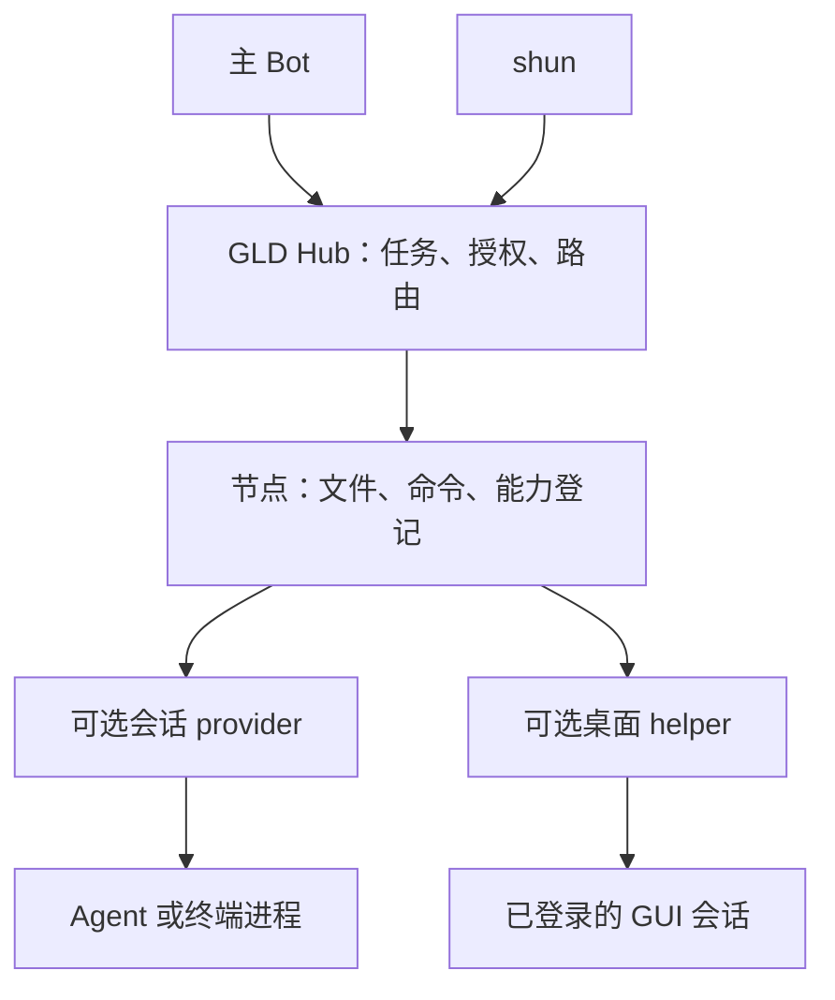

# RFC-0016：模块化执行节点、系统能力与 shun 集成

日期：2026-11-22。

本文定义可实施的设计和任务验收条件，**不表示这些功能已实现或部署**。排队、认领与完成状态只维护在
[task_plan.md](../../task_plan.md)；已有工具契约仍以 [concepts.md](../concepts.md) 为准。
本文补充 [RFC-0013](0013-native-machines-and-desktop.md)，沿用其 M0 → M1 → M2 → M3 → L0 → L1 主线，
不另建机器注册表、任务账本、执行器或连接协议。

## 1. 用户要得到什么

用户在一个主 Bot 或 shun 中选择项目、目标与可用机器。GLD 在授权范围内找到满足条件的执行环境，
完成命令、文件、Agent 会话或桌面操作，并把结果、失败原因与证据关联到同一个任务。
主 Bot 可依据计划继续推进，直到约定的验收条件满足，或遇到权限、资源、预算、外部依赖等明确阻塞。

每个**实际承担执行的操作系统环境**部署一个轻量 GLD 节点：

- Linux 主机、Windows 虚拟机、另一台 Mac 是三个执行环境，各自登记身份、权限、工具链与可用能力。
- Hub 所在机器可以复用本机执行路径；不为了“每台一份”再启动重复节点。
- 无桌面的云服务器只启用文件、命令等能力。需要 GUI 的机器再启用桌面模块。
- shun 作为手机端客户端时不需要部署 GLD 节点；手机本机自动化不在本次三桌面平台范围。
- 节点负责执行与报告；项目优先级、计划、模型推理和验收规则位于 Hub 或选定的 Agent runtime。
  不要求每台机器安装一整套主 Bot、模型服务和外网隧道。

“模块化”以可验证的独立性衡量：关闭桌面或某个第三方 provider 后，连接器、文件、命令及无关任务继续工作。
这需要明确依赖、权限与资源所有权，不能只靠把代码搬进不同目录。

## 2. 研究基线与已有工作的归属

2026-11-22 核对的 GLD 远端 main 为 `b51b90ac18f255aaf618d9953b94bc84ccd6f81e`，
shun 的源码基线为 `03340eaef9d4e0429d5f6dd42921415c53fd0d84`。
本轮只落设计文档，不把源码版本等同于已安装的二进制。

| 已有基础 | 本设计如何使用 |
| --- | --- |
| D17 拆分后的 policy / protocol / transport / runtime / agent / core / host / daemon / cli | 沿用现有边界；不重做 crate 拆分 |
| 原生节点 M0/M1、单条 WSS、NodeBridge、host 持有的 Nodes | 在原有路由上报告与调用可选能力；不创建第二个节点控制中心 |
| D18 统一 CallerId、凭据与项目范围 | 扩展显式能力授权；等待其远端调用与客户端验收收尾 |
| W0/W1 任务空间与产物 | 非项目操作需要空间时复用，并继续核对调用主体和资源归属 |
| RFC-0013 的 L0/L1 | 继续作为桌面工作的唯一任务归属；本文只是细分 |
| 已有 Task / Plan、运行记录与证据 | 增加必要的 attempt、失联处理及完成规则；保持一个权威账本 |
| shun 的 SSH、SFTP、RoutePlan、tmux、Agent CLI 会话 | 保留；GLD 通过窄接口提供新增信息和动作 |
| shun 的 R54 远端 workspace 研究 | 作为未来消费 GLD 接口的入口；不覆盖当前 R90 等任务 |

目前不能把已有任务元数据持久化解释成进程可恢复，也不能把退出码 0、Agent 的 done、空闲终端或截图
解释成项目完成。现有任务允许收尾时仍有 pending steps 等边界，见 concepts.md；D20 要补充明确的完成契约。

## 3. 部署与进程边界

### 3.1 同一产品，按需组合

图中各框是职责，不要求各自独立部署。首版采用已有模块边界与编译特性；进程隔离只用在 GUI 会话、
原生依赖或第三方 provider 确实需要的位置。暂不设计通用动态库 ABI、插件市场或任意代码热加载。

| 组件 | 生命周期与职责 | 故障影响 |
| --- | --- | --- |
| Hub | 现有控制入口；任务记录、授权、调度与状态聚合 | 重启后核对已知 attempt，不假定远端动作未发生 |
| 节点主体 | 随执行账户自启动；保持一条上行连接，负责本机执行和资源归属 | 离线时 Hub 报告失联；既有进程按明确策略运行或停止 |
| 桌面 helper | 需要时在选定的同用户 GUI 会话中启动；截图、输入、窗口观察 | 崩溃或退出只撤回桌面可用性，后台命令继续 |
| 会话 provider | 适配已有 Agent / 终端会话服务；可用外部进程承载 | 只影响关联会话，不自动改用另一实现或重建会话 |
| 自主推进模块 | 可选控制逻辑；读取计划、分配任务、检查证据与预算 | 关闭后停止新调度，保留已有记录和人工操作入口 |

已有用户会话能够直接承载桌面操作时，可在同一进程内实现。需要分离 helper 时，也只解决同一执行账户
内部的会话差异；跨账户提权、无人值守解锁、绕过系统授权不属于这一版。

### 3.2 平台必须实测的差异

| 平台 | 后台与桌面边界 | 首版验收要求 |
| --- | --- | --- |
| macOS | 系统级 daemon 与用户 GUI 会话不同；截图与辅助功能是独立权限 | 核对实际进程身份、录屏与辅助功能状态；拒绝、撤回、重新登录后能解释不可用原因 |
| Windows | 服务在 Session 0；交互桌面位于用户会话，输入还受完整性级别限制 | 使用对应用户 helper 与受限 IPC；锁屏、UAC / 高权限窗口不误报成功 |
| Linux X11 | 依赖被授权的 X display 与会话 | 无 DISPLAY 时命令照常工作；有桌面时验证窗口、坐标与输入 |
| Linux Wayland | ScreenCast 与 RemoteDesktop portal 能力、桌面环境和授权各有差异 | 按后端探测与实测；不得用 X11 通过推定 Wayland 通过 |
| 无 GUI 的云机 | 没有可操作桌面 | 返回 desktop unavailable 类原因，保留文件、命令和 Agent 能力 |

依据见文末 [S5]–[S9]。具体状态名和错误码在实现时纳入协议契约，此处表述不是已发布字段。

### 3.3 轻量的含义

默认节点不携带模型服务、全套 IDE、虚拟显示器或视频远控栈。桌面依赖按构建与运行配置选择；
外部 provider 显式安装、启用和探测。首先测量无模块节点的包体、空闲内存、CPU、连接数和启动时间，
再给扩展设定回归预算；没有实测前不承诺固定 MB 数或零开销。

只保留一条节点 WSS 连接。使用已有标准消息与有界缓冲，长输出、终端和图片必须避免阻塞取消及心跳。
不额外发明消息确认、离线输入重放、永久连接恢复协议。

## 4. 模块契约

### 4.1 首批能力及默认策略

以下名称是设计分组，不是现成 CLI 子命令或 MCP 工具名。

| 分组 | 作用 | 默认与依赖 |
| --- | --- | --- |
| 文件与命令 | 项目内读取、写入、普通命令、运行记录 | 沿用现有核心能力与项目策略 |
| 桌面观察 | status、targets、按需截图 | 可选；依赖 GUI 会话和平台观察权限 |
| 应用打开 | 打开已验证的应用、项目文件、目录或允许的 URL | 可选；不能把任意 shell 拼接当作应用打开 |
| 桌面输入 | click、scroll、type、key | 可选且独立授权；依赖会话、目标与短控制租约 |
| 剪贴板 | 显式读取或写入 | 与截图分开授权，不在背景轮询 |
| 会话 provider | 列举、观察、附着已有 Agent / 终端会话 | 可选；每个 provider 单独登记版本与能力 |
| 项目自主推进 | 计划拆分、调度、验收与继续推进 | 可选；依赖任务契约和恢复语义，不依赖 GUI |
| 机器 provisioner | 按需申请 / 回收预先允许的云机或 VM | 后期可选；显式预算、配额与资源归属 |

浏览器继续复用 Playwright 等现有边界；远程视频桌面可作为独立外部服务按需接入。
截图加输入不等同于低延迟视频远控，不把两类产品的交付范围混在一起。

### 4.2 可用性不能只有一个布尔值

能力快照至少需要区分：

1. supported：当前平台和构建是否支持。
2. installed：所需组件或外部 provider 是否存在。
3. enabled：用户是否在当前节点启用。
4. available：当前会话、依赖进程与资源是否就绪，并带观察时间和有效期。
5. authorized：针对当前调用主体、目标和动作是否被允许。

前四项来自节点探测；authorized 在请求时结合 Hub 与节点策略计算，不能作为全局共享的“有权限”标记。
列表必须按调用者可见范围裁剪；能力存在不等于可以枚举其他人的会话、窗口和项目。

调用参数围绕稳定的 workspace / machine / provider session 身份；显示名和 IP 只作展示。
桌面路由仍从 workspace 唯一确定节点；必要的通用任务空间复用 W0/W1。
请求不得同时提供互相矛盾的 workspace 与 machine，也不得用名称匹配悄悄切换目标。

### 4.3 启停、版本与兼容

模块应声明协议版本、依赖、提供的操作及资源所有者。关闭时先停止接收新动作，再按已公布策略
等待完成或取消本模块的在途操作；有停止期限，超时后保留明确结果，不无限等待。
释放控制租约、句柄和订阅，撤回能力可用性，保留最小任务证据。

模块重新启用时使用新的实例代次，旧 handle 和租约不能复活。模块退出不终止其他模块创建的命令；
用户原有应用和 tmux 会话也不归 GLD 随意清理。
强制停止会终止哪些自有子进程必须在任务记录中可查。卸载模块不删除任务历史。

内部增加请求形状时遵守现有 PROTOCOL_VERSION 约定；对外版本不兼容时拒绝并说明升级要求，
不静默删掉输入参数或改用权限更强的后端。新版本与旧节点、模块缺失、协议未知均有固定样例测试。

## 5. 授权、桌面与结果语义

### 5.1 权限复用现有体系

有效权限是 Hub 授予范围、节点本地允许范围以及操作系统实际授权的交集。
新增桌面、会话控制能力应在 D18 的同一授权模型上显式声明。

AllProjects 只解决项目集合；现有 service-access 固定组合也不应自动获得截图、输入、剪贴板或任意会话控制。
只读任务列表不应顺带授予会话输入。shun 的外部插件通过窄接口获得已声明能力，不能因此取得
Vault、通用 exec、未裁剪的 machine MCP relay 或其他项目权限。

按 workspace 约束的普通命令不是操作系统沙箱。面向不可信项目的强隔离需要单独的执行环境；
不能用路径检查宣传跨用户、跨进程或桌面的强隔离。

### 5.2 每个截图必须能回答“看到的是什么时候、哪个桌面”

截图结果应关联 opaque frame ID、目标、GUI session generation、时间、像素尺寸及坐标变换。
实际采用像素坐标还是逻辑坐标，在协议中固定；不能交给客户端猜缩放比例。
显示器重排、分辨率 / DPI 改变、用户切换、锁屏、helper 重启都会使相关旧状态失效。

截图尺寸和压缩遵守既有消息上限；超大图片使用现有受限产物读取机制或明确拒绝，
不能塞满控制连接。产物携带来源、摘要、时效与访问范围，返回可用的受控引用；
节点本地路径不能冒充客户端可下载的 URL。

截图按需生成，默认不连续采集，不无限保存桌面内容。日志不记录图像正文或访问凭据。

### 5.3 桌面输入是独占的短操作

同时操作同一 GUI 会话的 GLD 任务须争用短控制租约。每次输入核对调用者、workspace、目标、
session generation、租约与必要的 frame ID；过时目标要求重新观察。
连接恢复只恢复观察与状态核对，**不重放之前未知是否送达的点击、键入或快捷键**。

用户显式接管、任务取消、权限撤销或会话失效后，拒绝后续输入并撤销租约。
这只约束 GLD 发出的动作，不声称能锁住本地人的鼠标键盘。发现干扰或无法核对焦点时停止当前输入。
对已按下的修饰键执行有界释放；无法确认释放时报告未知，不继续发送下一串组合键。

输入被操作系统接收、目标窗口发生变化、业务操作完成是三种不同证据。
打开应用也分别报告“已发出启动请求”“已观察到目标窗口”“任务结果已验证”；
仅进程创建成功不能当作软件打开成功。

## 6. 会话 provider：借鉴能力，保留边界

### 6.1 Herdr 是两种需要分别适配的实现

官方文档区分 Herdr TUI 与 Herdr Core，两者不共享 agent session [S1]。
不能因为名字相近就把 socket schema、命令参数或会话 ID 混用。

| 实现 | 可以借鉴 / 适配 | GLD 边界 |
| --- | --- | --- |
| Herdr TUI | 常驻会话服务、会话与 pane 枚举、观察 / 事件、受控输入 | 使用安装版本实际提供的 schema；只读先行，再单独授权输入 [S2] |
| Herdr Core | 终端 / Agent 程序的后台运行、附着、读取、输入与 schema | 作为独立 provider；预览协议按实际版本固定样例 [S3] |
| GLD 现有 Agent | 自有启动、查询、停止与记录 | 保留为已有 provider，不绕过 core 的授权和任务状态 |

provider 报告的 idle、done 或退出码只是其自身观察，不能直接完成 GLD 的 Goal。
终端前端关闭、provider 服务退出、Agent 进程退出、宿主重启也必须分开记录；
“关闭界面后继续运行”不等于断电后进程仍存在。

### 6.2 “ocra”先确认具体项目

用户写的是 ocra；目前没有足够证据把它唯一对应到某个产品。两项可核对的候选：

- Stably 的 Orca：有远程服务器、Agent 会话与 computer use 文档，适合参考多机工作区和系统操作 [S4]。
- Open-CR-Agent：CLI 名称是 ocra，定位代码审查，应归 ReviewProvider，而不是桌面或终端底座 [S10]。

通用模块契约可以先做。对应适配任务开始前记录用户指向的仓库、版本、许可证、官方接口和复现样例；
不按相似拼写安装某个软件，不依赖其私有内部数据文件。

若指 Orca，GLD 仍保留自己的任务与权限权威；只调用所需接口，不把对方的 workspace / session / dispatch
账本当作第二份 GLD 任务状态。若指 Open-CR-Agent，则只接入审查输入、结果和证据接口。

### 6.3 四种身份不能合并

| 身份 | 意义 | 恢复方式 |
| --- | --- | --- |
| GLD task / attempt | 用户目标中的工作及一次执行尝试 | 查权威任务记录并与远端实际状态对账 |
| provider session | Herdr、现有 Agent 等提供者管理的会话 | 核对 provider 身份、版本及实际存活状态 |
| terminal attachment | 一个客户端对会话的观察 / 输入连接 | 可重连，但不自动重放输入或另起 shell |
| GUI session | 某登录用户的桌面实例 | generation 改变后旧目标和输入租约失效 |

使用 provider 原生恢复能力时，先确认它恢复的是历史、会话还是进程。无法核对的执行结果保留 unknown，
不能靠相同名字、PID 或一个旧 session ID 判定是同一实例。

## 7. shun 如何消费这些能力

shun 已有 Flutter、SSH 真 PTY、RoutePlan、SFTP、tmux 与 CLI 会话能力。
其网络策略仍由 RoutePlan 决定；跳板 / 代理失败不得自动直连。
本设计不把 GLD 接入做成绕开这些策略的旁路，也不将 Headscale 测试环境写成已具备的设备目录功能。

### 7.1 窄接口与客户端职责

优先为现有 GLD 公开协议建立 typed consumer adapter，不为手机另建一套任务 API 和授权系统。
接口裁剪和实际传输方式在 C1 中确认；向 shun 内部或外部插件暴露的都是有限操作，不是任意 MCP 转发。

| shun 页面或动作 | GLD 提供 | shun 继续负责 |
| --- | --- | --- |
| 机器与项目 | 已授权机器、workspace、能力、最近状态 | 本地设备目录、展示、显式关联 |
| 任务与进度 | task / attempt、状态原因、日志游标、产物引用 | 展示、过滤、通知偏好与断线反馈 |
| 查看终端 | provider session 的受控引用与附着描述 | 既有终端渲染、输入所有权、SSH / tmux 路径 |
| 查看桌面 | 按需截图、目标与坐标信息 | 展示、缩放、显式操作和过期提示 |
| 打开应用 / 输入 | 授权后执行并报告观察结果 | 用户意图与任务上下文；不在 UI 中拼接 shell |
| 暂停 / 取消 / 审批 | 当前主体可执行的动作和可核对结果 | 清楚区分暂停调度与终止运行 |

设备绑定使用 hub identity + machine identity + workspace identity；IP、主机名、昵称不作为自动合并依据。
Hub 返回的 URI 或终端描述不能携带账号秘密、任意启动脚本或替客户端改变 RoutePlan。

### 7.2 复用现有终端，按需扩展

shun 的 SSH/tmux 路径是第一选择。保留 TmuxTarget 的主机绑定标识 hostKey、用户、socket / server generation、
session ID 与创建时间；hostKey 不是 SSH 公钥指纹，指纹仍按既有连接策略逐跳验证。
识别某次 AI 运行还需核对专属 window / pane 与工作项的关联，只有 tmux session 存活不足以证明 AI 仍在运行。
旧目标消失时不得静默新建同名会话。Herdr 附着使用其明确协议；已有 Agent resume 仍遵守 shun R55–R57。

只有真实场景证明这些 provider 不够时，才研究内建 PTY。普通 exec 的管道输入不叫真 PTY；
Unix PTY 与 Windows ConPTY 需要单独处理大小、原始字节、控制字符、输入所有者与断开语义 [S9]。
本轮不把真实 PTY 重新列为默认开发项，D19-T1/T2 优先验证现有 provider 的终端契约。

### 7.3 跨仓库交付

GLD 提供协议说明、脱敏样例、兼容用例及服务端证据。shun 的代码任务落在其自己的
plan/v3/tasks.json 与 STATUS.md，按该仓库现有规则更新，关联 R54 或明确的新任务。
本文中的 C1–C4 是 GLD 侧契约与联调交付，不是 shun 当前任务的第二份状态表。

## 8. 主 Bot 如何可靠地持续推进

主 Bot 是用户可见入口和项目管理角色，不是唯一常驻大模型进程。
自主推进模块读取同一任务账本，把计划变成有依赖的工作项；调度器选择机器，Agent 处理限定工作，
验证器核对结果，完成后再决定下一步。角色可以先在同一模块中实现，不因角色多就拆成多个服务。

### 8.1 执行输入和证据

每次 attempt 固定代码 commit / 工作区快照、工具链与依赖摘要、目标平台、允许的操作、预算和验收命令。
各机器使用独立工作目录或 managed worktree；代码通过 Git 对象 / 明确补丁流转，
不让不同系统同时写同一个共享目录的构建产物、依赖目录与临时文件。

并行 worktree 要分别协调工作树写入和共享 Git 元数据。
多个 Agent 的分支通过集成步骤合并；最终检查针对实际集成后的快照执行。
修改代码、相关配置或依赖后旧证据失效，不能拿合并前的全绿结果完成新版本。

### 8.2 可靠推进需要明确“未知”

持久化调度意图、attempt、租约、幂等请求键和结果引用；控制器可以重启后继续核对。
同一原子写入无法覆盖任务记录与外部副作用时，采用明确的提交 / 对账步骤，不能宣传 exactly-once。

节点失联、进程退出与调用超时分开记录。对可能已经执行的命令、键入、提交或发布先查状态；
非幂等动作结果未知时阻塞该分支，不盲目重试。任意 shell 命令不能仅靠一个 request ID 获得可重放语义。

调度暂停只停止发起后续步骤；取消需要向实际资源所有者发出停止请求并核对。
清理只针对任务拥有的 worktree、进程和 provisioned 资源，保留取证所需信息。

### 8.3 完成、阻塞和资源边界

Goal 需要显式完成条件：必需任务和计划步骤已满足、必要检查在当前快照通过、审查结论已处理、
所需产物可访问。可选检查、平台缺失和已接受的豁免单独记录，不能自动视为通过。

推进由任务结束、依赖解除、机器可用和定时检查等事件触发；周期检查有上限并去重，
不让 LLM 无意义地一直循环。每个项目设置并发、总时长、调用费用、失败重试和无进展上限。
资源或授权不足时标记阻塞及下一次检查条件，条件恢复后再继续。

规划、执行、审查和测试可以按风险选择同一或不同 Agent；关键变更要有独立检查证据，
不要求每个小修都建立完整的多 Agent 流程。项目内容、工具输出与远端页面作为输入数据处理，
不能修改 Hub 的授权、预算和完成条件。

按需申请云机 / VM 使用可选 provisioner。先连接已有机器，再扩展一种有真实需求的 provider。
申请前核对平台可用性、用户已有授权、预算与配额；保留租约和可重试的回收记录。
未核实的 macOS 托管条件、硬件条件或平台条款不能当作“任意云机上都能启动 Mac”的实现承诺。

## 9. 详细任务：30 个可独立验收的工作项

任务状态只在 task_plan.md。下面定义依赖、改动范围和“完成需要看到什么”，不维护第二份勾选清单。
实施者每次认领一个可验证的小项；运行代码变化同时更新 concepts.md 的实际契约。

### 9.1 D19-A：模块与授权基础（4 项）

**D19-A1：能力描述、身份与错误契约**

- 依赖：核对 D18 统一身份与授权契约；先做协议样例，不抢占其当前队列。
- 改动：在现有 protocol/core 边界定义能力快照、查询过滤、workspace 到 machine 路由与稳定错误原因。
- 验收：同一节点对不同主体返回不同可见集合；supported / installed / enabled / available / authorized 可区分；
  混用 workspace 与 machine、旧快照、未知协议版本有确定结果。

**D19-A2：模块装配与退出**

- 依赖：A1；改动落在现有 host/runtime 的装配点，按需要使用 feature 或独立 provider 进程。
- 改动：定义注册、探测、停止接收、等待 / 取消、退出与能力撤回；为桌面依赖保留 headless 构建。
- 验收：无 GUI 依赖的节点仍能接入、读写和执行；关闭或崩溃一个模块不终止其他模块任务；
  超时退出可观察，不留下输入所有权或无限缓存。

**D19-A3：同用户 GUI helper 与会话登记**

- 依赖：A1/A2，以及 M2 对应平台安装链路。
- 改动：优先使用已有用户会话；确需 helper 时定义受限 IPC、对端身份、session generation、启动与退出。
- 验收：错误账户或错误会话不能发送动作；退出登录、helper 崩溃、锁屏和重新登录撤回旧能力；
  不以 root / 管理员提权作为普通桌面能力的前提。

**D19-A4：显式能力授权与兼容**

- 依赖：D18-C/E 的远端授权语义、A1。
- 改动：在同一授权模型上表达桌面观察、输入、剪贴板和会话控制，复用 CallerId 与节点本地裁剪。
- 验收：AllProjects 与既有 service-access 不自动扩大权限；只读主体不能输入；
  撤权在后续动作生效，跨任务 / 跨主体操作失败；旧节点仍可使用已支持的核心工具。

### 9.2 D10-L0：观察与打开，复用原任务归属（4 项）

**D10-L0.1：桌面状态与目标**

- 依赖：M3、A1/A3/A4。
- 改动：聚合 status / targets，区分系统、GUI 会话、应用与窗口身份。
- 验收：无桌面、未授权、锁屏、目标已退出返回不同原因；不泄露不可见窗口；命令能力不受影响。

**D10-L0.2：截图、坐标与产物**

- 依赖：L0.1。
- 改动：按平台捕获、压缩，绑定 frame / target / session generation、时间与坐标变换，复用产物访问控制。
- 验收：真实多屏与 DPI 变化后新截图可定位，旧 frame 不可用于当前输入；超大截图不阻塞控制链路；
  不把缓存旧图当作本次截图，不输出无效的本地下载路径。

**D10-L0.3：类型明确的应用 / 文件 / URL 打开**

- 依赖：L0.1、现有 workspace 路径策略。
- 改动：使用应用标识与类型化目标，核对文件归属和允许的 URL 类型，记录启动请求与窗口观察结果。
- 验收：路径穿越、任意 shell 拼接、失效应用标识被拒；已运行应用不被误当成任务自有进程；
  启动请求接受但窗口未出现时不返回“已验证打开”。

**D10-L0.4：三平台观察闭环**

- 依赖：L0.1–L0.3。
- 改动：准备独立测试应用与可复现步骤，在 macOS、Windows、Linux X11 / Wayland 分别登记支持边界。
- 验收：从 Hub 经真实节点执行 status → targets → screenshot → open → 再观察；
  包含权限拒绝 / 撤回、锁屏与会话退出；未实际拥有的平台记 NOT_RUN 或 BLOCKED，不能以编译替代。

### 9.3 D10-L1：输入与剪贴板（3 项）

**D10-L1.1：控制租约与目标校验**

- 依赖：L0.4、A4。
- 改动：同一 GUI 会话独占的短租约，逐动作校验 owner、generation、frame 与目标状态。
- 验收：两个任务争用时只有一个可输入；过期 frame、旧租约、焦点变化或会话切换要求重新观察；
  断线恢复没有输入重放。

**D10-L1.2：基础输入、停止与干扰**

- 依赖：L1.1。
- 改动：实现 click / scroll / type / key，按平台核对 Unicode、键盘布局、快捷键与修饰键释放。
- 验收：中文、换行、组合键与滚动在测试应用可核对；取消、撤权、helper 崩溃后没有后续键入；
  明确系统拒绝、焦点不符与执行结果未知，不将 API 接受等同于业务成功。

**D10-L1.3：显式剪贴板**

- 依赖：L1.1、A4。
- 改动：独立授权的 read / write；定义大小、格式、保留与错误规则，不后台采集。
- 验收：只有截图权限时读不到剪贴板；关闭模块释放句柄；取消流程不擅自覆盖用户后来复制的内容；
  敏感正文不进常规日志。

### 9.4 D19-S：会话 provider（5 项）

**D19-S1：统一会话观察契约**

- 依赖：A1/A4。
- 改动：从已有 Agent 查询能力抽取最小适配面，区分 provider session、task attempt、attachment 与进程。
- 验收：能表示 running / exited / unavailable / unknown 及来源时间；provider 的 done 不触发 Goal 完成；
  列表、日志和动作均保留 owner 与 workspace 检查。

**D19-S2：现有 SSH / tmux 与 Agent 交接**

- 依赖：S1；对照 shun 现有 R55–R57 与 tmux 契约。
- 改动：定义受控附着描述与稳定目标引用，优先复用已有终端能力。
- 验收：关闭 UI 后任务是否继续由资源所有者决定；重连不会另起 shell、重发启动命令或挤掉其他客户端；
  已消失的会话不按名字自动替换；保留 socket / server、window / pane 与工作项运行关联；
  仅终端存活时工具状态可为 unknown，原进程退出后的原生继续须显式使用可靠 ID。

**D19-S3：Herdr TUI adapter**

- 依赖：S1、具体版本与许可证核对。
- 改动：固定安装版本 schema，先 list / get / read / events，再开放单独授权的输入。
- 验收：脱敏样例与真实会话一致；服务未安装、协议不符和断开可解释；
  无权限输入失败，禁用 adapter 后 GLD 自有 Agent 继续工作。

**D19-S4：Herdr Core adapter**

- 依赖：S1；独立于 S3，不复用 TUI 会话 ID 或假设。
- 改动：核对该版本 OpenRPC/schema，适配后台会话、读取、附着与停止。
- 验收：分别记录前端退出、服务退出、Agent 退出和宿主重启；预览版本不兼容时明确拒绝；
  原生恢复能力经过实测后才向上报告。

**D19-S5：ocra 指向与适配决定**

- 依赖：取得明确仓库 / 产品链接，核对版本、许可证与公开 API。
- 改动：若为 Orca，选择需要的 session / workspace / desktop 接口；若为 Open-CR-Agent，只做审查 provider；
  若为其他项目，先给最小契约与复现样例。
- 验收：形成来源可核对的适配决定；有接口样例和失败边界后才开始代码；
  身份尚未确定时此 adapter 保持阻塞，不阻塞 GLD 通用模块。

### 9.5 D19-T：终端契约与是否内建的判断（2 项）

**D19-T1：终端场景与 provider 能力矩阵**

- 依赖：S1/S2；按用户实际需要检查 Herdr 等 provider，不要求全部安装。
- 改动：对照交互 CLI、Unicode、resize、Ctrl-C、detach、resume 和多客户端输入。
- 验收：给出哪些场景由 shun SSH/tmux 或现有 provider 完成，哪些有可复现缺口；
  不把管道 exec 宣称为 PTY，不为没有缺口的场景另建终端执行器。

**D19-T2：附着数据流与有界资源**

- 依赖：T1 确认的 provider 与场景。
- 改动：验证原始字节、输出游标 / 间隙、背压、单输入 owner、尺寸与 detach / stop 的契约。
- 验收：慢客户端不无限占内存，不阻塞取消 / 心跳；断线不重放输入，缺失输出有明确标记；
  若确实需要内建 Unix PTY / ConPTY，另记需求决定与范围，再拆实现任务。

### 9.6 D19-C：交给 shun 的消费契约（4 项）

**D19-C1：只读能力与任务 API 样例**

- 依赖：A1、S1、D18-E。
- 改动：提供版本化 typed adapter 说明、机器 / workspace / task / attempt / log cursor / artifact 样例。
- 验收：只读客户端看到正确裁剪结果；凭据由 shun 既有安全存储处理；
  外部插件拿不到通用 exec、Vault 或任意 MCP relay。

**D19-C2：设备绑定、路由与终端联调**

- 依赖：C1、S2、shun 对应任务已登记。
- 改动：显式绑定稳定身份；使用 frozen RoutePlan 和 provider 原生附着协议。
- 验收：同名机器不会误合并，代理 / 跳板失败无直连回退，设备重装 / 会话失效可识别；
  恢复连接不重复启动终端或 Agent。

**D19-C3：截图查看与显式应用操作**

- 依赖：C1、L0.4；输入功能另依赖 L1。
- 改动：提供图片 / 目标 / 坐标样例与最小消费流程，说明时效和只读 / 可控状态。
- 验收：手机缩放不改变服务端坐标语义；旧图不能直接用于新会话输入；
  打开请求、观察到窗口与操作完成在界面和协议中可区分。

**D19-C4：任务控制与授权联调**

- 依赖：C1/C2、实际任务控制契约。
- 改动：定义暂停新调度、取消在途执行和处理审批的权限及结果；复用现有通道。
- 验收：跨主体动作被拒；取消发出但未确认停止时有中间状态；重复请求不扩大副作用；
  shun 断线重连后按权威状态刷新，不把本地 UI 状态写回为完成。

### 9.7 D19-Q：独立性与交付质量（2 项）

**D19-Q1：模块故障与权限矩阵**

- 依赖：每个模块自己的最小闭环；贯穿各阶段，不等全部完成才验证。
- 改动：统一执行下节验收矩阵，记录版本、平台、身份、操作与可核对结果。
- 验收：模块禁用、进程崩溃、撤权和连接断开不会扩大权限或破坏无关任务；
  结果区分 PASS / FAIL / NOT_RUN / BLOCKED，真实平台证据可追溯。

**D19-Q2：打包、升级与资源预算**

- 依赖：A2、M2/M3、至少一个可选模块。
- 改动：验证 headless 与桌面包、按需组件、身份 / 连接器兼容、模块版本诊断及可回收资源。
- 验收：测量默认节点与模块启用后的增量；无意外 GUI 依赖与常驻扫描；
  普通升级保持既定连接器地址和身份语义，D18 已明确的切换要求单独处理，不承诺零中断。

### 9.8 D20-A：可选自主项目推进（6 项）

**D20-A1：Goal 与完成证据契约**

- 依赖：既有 Task / Plan、证据与当前收尾规则核对。
- 改动：定义必需步骤、检查、审查与豁免；把 pending steps、当前快照和证据有效性纳入完成判定。
- 验收：空命令退出 0、provider done、遗留必需步骤或过期证据都不能完成 Goal；
  失败与阻塞原因可被主 Bot 和 shun 读取。

**D20-A2：managed worktree 与跨机输入**

- 依赖：A1、M3。
- 改动：为可并行工作创建独立工作树 / 快照，协调共享 Git 元数据，记录输入与最终集成结果。
- 验收：两个任务不互相覆盖工作目录；跨平台检查使用相同代码输入和各自构建目录；
  合并后的最终快照重新验收，清理不删除用户工作树。

**D20-A3：attempt、租约与失联对账**

- 依赖：A1、现有 Store 与运行记录；必要时对同一存储做事务化迁移，不建第二份账本。
- 改动：持久化调度意图、attempt、租约、幂等键与已确认结果，定义 unknown 和恢复流程。
- 验收：在“记录前后、派发前后、结果回传前后”注入重启 / 断线；
  不重复执行未知副作用，不丢失已确认结果，取消与暂停语义不混淆。

**D20-A4：事件驱动推进与项目预算**

- 依赖：A1/A3。
- 改动：按依赖和能力选择下一步与机器；加入并发、费用、时间、重试和无进展上限。
- 验收：目标完成后停止，阻塞时给出原因与恢复条件；重复事件不重复派发；
  主 Bot 重启后从账本继续，关闭自主模块后人工调用仍可用。

**D20-A5：规划 / 执行 / 审查 provider 与一个完整案例**

- 依赖：A1–A4、可用的现有 Agent provider。
- 改动：用一个真实项目跑“计划 → 修改 → 审查 → 修复 → 平台检查 → 验收”，按需要选不同模型。
- 验收：过程、输入、补丁、审查与最终证据可追溯；项目内容不能提高自身权限或删除完成条件；
  至少验证一次恢复和一次明确阻塞，不用一段聊天记录冒充自治运行记录。

**D20-A6：按需机器 provisioner**

- 依赖：A3/A4，以及明确的机器供应场景、授权与费用边界。
- 改动：先接一个 provider，声明机器能力、准备流程、租约、使用预算与失败回收。
- 验收：创建超时后能查资源是否已存在，不重复付费创建；失败、取消和控制器重启后能回收自有资源；
  配额不足 / 平台不可用明确阻塞，不变成通用云平台或默认 Kubernetes 依赖。

## 10. 推进顺序与第一个可交付场景

当前 D18 收尾保持优先。D19 可以先完成文档、样例和局部类型设计；实际远端能力开放必须满足
对应授权与协议依赖。M2/M3 的多机基础先于 L0，L0 先于 L1，沿用已有决定。

推荐最短产品闭环：

1. 完成 D18 和 M2/M3 当前缺口，让真实 Linux、Windows、Mac 执行环境可靠接入。
2. A1/A2/A4 + S1/S2 + C1/C2，并完成 shun 对应任务的实现与联调：手机端可查看授权机器、项目、任务与既有会话，
   回到原终端继续。仅完成 GLD 接口与样例时，只交付服务端契约，不标记手机功能可用。
3. A3 + L0 + C3：在一台有真实需求的桌面机器完成观察 / 打开，再补其余平台的明确支持边界。
4. L1：有目标、权限、租约和退出语义后再开放输入；持续运行 Q1/Q2。
5. S3/S4/S5 按实际安装的 provider 接入，不要求同时实现所有第三方适配。
6. D20 先选一个小型项目跑完闭环，再扩到跨项目优先级、更多 Agent 和机器按需申请。

D20 的无桌面路径可以与桌面模块并行推进，但必须满足其自身证据与恢复依赖。
自主推进不以三个桌面平台全部实现作为前置；桌面输入也不因“需要自主”而跳过会话和权限验证。

## 11. 共用验收矩阵

| 场景 | 必须观察到的结果 |
| --- | --- |
| headless 节点没有显示环境 | 文件和命令正常；桌面有具体不可用原因 |
| 禁用桌面或 Herdr adapter | 无关命令继续；相关能力撤回；任务结果仍可查看 |
| helper 崩溃 / 注销 / 切换用户 | generation 更新，旧目标与租约失效 |
| 锁屏或系统拒绝输入 | 明确拒绝 / 未知；没有“操作已完成”的假成功 |
| 截图权限与输入权限不同 | 各自报告；截图授权不能推导输入授权 |
| 多屏重排 / DPI 改变 | 坐标重新建立，过期 frame 不再驱动输入 |
| 两个任务控制一个桌面 | 明确争用；无交错键入 |
| 连接中断后恢复 | 先核对状态，不重放未知输入或启动命令 |
| 慢日志 / 大图 / 慢终端消费者 | 内存有界；取消与心跳仍及时；丢失或截断可识别 |
| 应用接受启动但没出现窗口 | 仅报告请求状态，不宣称已观察到应用 |
| provider 报 done | 更新 provider 状态；不直接完成项目 |
| 任务 cancel / pause | cancel 核对实际停止；pause 不虚称已杀进程 |
| 最终代码被再次修改 | 相关旧测试证据失效，需要重新验收 |
| Hub 在派发或回包途中重启 | 已确认结果不丢，未知副作用先对账 |
| shun 路由失败 / 会话消失 | 不直连回退，不另建同名会话 |
| 费用 / 时间 / 无进展达上限 | 停止新派发，给出阻塞与后续条件 |
| 模块卸载 / 普通升级 | 不删除历史或用户应用；兼容性按已公布规则核对 |

每份证据记录源码与制品版本、平台 / 后端、执行账户角色、输入快照、预期和实测结果。
测试使用隔离配置、专用项目与测试应用；真实业务桌面、凭据或发布操作按已获得的授权处理。
性能指标以测量为准；产品工作未实现的部分不写“已支持”。

## 12. 实施前的约束与取舍

- 先做一个模块可关闭的完整闭环，再抽取确实复用的接口；不先搭一个比需求更大的插件框架。
- 新 provider 必须给出独立价值、稳定接口与故障处理。已可由 SSH/tmux/现有 Agent 完成的工作优先复用。
- 保持现有连接器体验；功能安装与功能授权分开，模块数量不直接扩大权限。
- 当前桌面范围是观察、打开与基础输入；实时视频、跨用户桌面、移动设备自动化分别立项。
- 当前默认范围仍不包含内建真 PTY、完整 IDE / 云平台、第二套 Goal / Plan / Task。
- ocra 项目身份、各平台真实支持范围、资源预算与 provider 版本兼容必须在相应任务中取得证据；
  这些不确定项有明确归属，不阻塞已经确定的基础设计。

## 13. 来源与核对入口

以下外部资料用于说明产品边界与平台限制；架构选择、任务拆分及验收标准是本 RFC 的设计。
实现时重新核对实际安装版本，不把网页当前行为当作永久协议保证。

- **S1**：[Herdr FAQ](https://herdr.dev/faq)；[Herdr TUI 源码](https://github.com/herdrdev/herdr)。
- **S2**：[Herdr TUI Socket API](https://herdr.dev/tui/docs/socket-api/)。
- **S3**：[Herdr Core](https://herdr.dev/core/)；[Core schema](https://github.com/herdrdev/herdr-core/blob/master/schema/README.md)。
- **S4**：[Orca Remote Servers](https://orca.dev/docs/remote-servers)；[Computer Use](https://orca.dev/docs/cli/computer-use)；
  [源码](https://github.com/stablyai/orca)。
- **S5**：[Apple：Designing Daemons](https://developer.apple.com/library/archive/documentation/MacOSX/Conceptual/BPSystemStartup/Chapters/DesigningDaemons.html)。
- **S6**：[Microsoft：Interactive Services](https://learn.microsoft.com/en-us/windows/win32/services/interactive-services)。
- **S7**：[XDG ScreenCast portal](https://flatpak.github.io/xdg-desktop-portal/docs/doc-org.freedesktop.portal.ScreenCast.html)。
- **S8**：[XDG RemoteDesktop portal](https://flatpak.github.io/xdg-desktop-portal/docs/doc-org.freedesktop.portal.RemoteDesktop.html)。
- **S9**：[Microsoft：Creating a Pseudoconsole Session](https://learn.microsoft.com/en-us/windows/console/creating-a-pseudoconsole-session)。
- **S10**：[Open-CR-Agent](https://github.com/jma49/Open-CR-Agent)。
- **S11**：[Devin Outposts](https://docs.devin.ai/cloud/outposts/overview)。
- **S12**：[Git worktree](https://git-scm.com/docs/git-worktree)。

本仓库核对入口：AGENTS.md、task_plan.md、RFC-0013、concepts.md、Cargo.toml、
crates/host 的节点所有权与路由、core 的授权 / 任务记录，以及生命周期审查 §147–§149。
shun 核对入口：AGENTS.md、plan/v3/AGENTS.md、STATUS.md、docs/dev/architecture.md、
plan/v3/docs/08-implementation-tasks.md 中 R54–R57、网络与终端相关实现。
